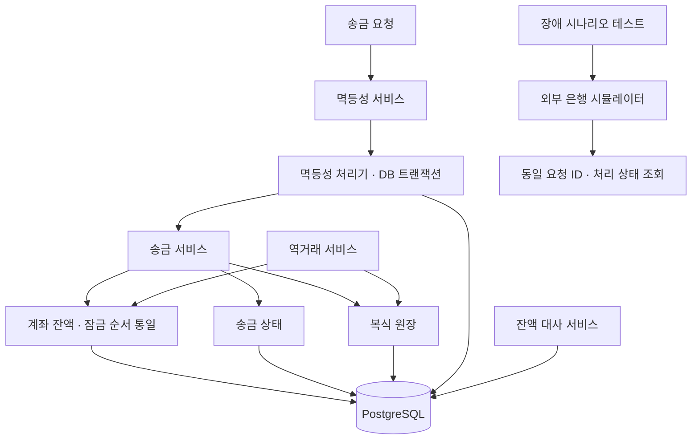

# FinLedger

> **금융 거래의 정확성을 장애 상황에서도 검증하는 Java/Spring 백엔드 프로젝트**  
> 계좌이체의 원자성·동시성부터 복식 원장, 잔액 대사, 역거래, 멱등성, 외부 은행 장애, 커넥션 풀 고갈까지 **문제 재현 → 해결 → 자동화 테스트**로 검증했습니다.


## 프로젝트 개요

| 항목 | 내용 |
|---|---|
| 목표 | 송금 실패·동시 요청·중복 요청·외부 시스템 장애에서도 금융 데이터의 정합성을 유지·검증 |
| 핵심 기술 | Java 21, Spring Boot, Spring Data JPA, PostgreSQL, Docker Compose, JUnit 5, AssertJ |
| 구현 범위 | 회원·계좌·입출금·내부 송금·거래 상태·복식 원장·잔액 대사·역거래·멱등성 |
| 장애 실험 | 롤백, 갱신 손실, 낙관적 락 충돌, 교착 상태, 원장 불일치, 중복 요청, 외부 은행 HTTP 500·타임아웃, 커넥션 풀 고갈 |
| 외부 시스템 | 독립 Spring Boot `external-bank-simulator`로 처리 전/후 장애와 처리 상태 조회 검증 |
| 다음 확장 | 외부 송금 연동·Resilience4j·Kafka·Outbox·정산 배치·성능 측정 |

## 핵심 구조



**핵심 설계 원칙**

- **원자성:** 멱등성 기록·송금 상태·잔액 변경·원장을 동일 PostgreSQL 트랜잭션으로 처리합니다.
- **동시성:** 실제 송금·역거래에는 비관적 행 락을 적용하고, 계좌 ID 오름차순으로 잠금을 획득합니다. `@Version`과 재시도는 비교·안전성 실험에 사용합니다.
- **추적성:** 성공한 송금마다 균형 잡힌 원장을 기록하고, 취소 시 원본을 삭제하지 않고 역거래를 추가합니다.
- **중복 방지:** 멱등성 키의 `UNIQUE` 제약과 동일 요청 검증으로 같은 금융 효과가 두 번 실행되는 것을 방지합니다.
- **외부 장애:** HTTP 오류·타임아웃과 실제 거래 결과를 구분하고, 동일 요청 ID를 통한 상태 조회로 처리 결과를 확인합니다. 처리 전·후 장애, 응답 지연, 중복 요청 및 요청 충돌 시나리오를 모두 테스트하여 검증했습니다.
- **트랜잭션 경계:** 외부 응답을 기다리는 동안 DB 커넥션을 붙잡지 않도록, 외부 대기는 트랜잭션 밖에 두고 DB 작업만 짧은 트랜잭션으로 실행해야 함을 커넥션 풀 실험으로 검증했습니다.

## 문제 해결 사례 — STAR-L

> **S** 상황 · **T** 해결 과제 · **A** 수행 행동 · **R** 검증 결과 · **L** 학습/선택 근거. 수치는 부하 성능 지표가 아니라 해당 테스트의 **입력 조건과 관찰 결과**입니다.

### 01. 송금 중 장애: 트랜잭션 원자성

- **S:** 30,000원 이체 도중 출금 후 예외가 발생해 `A 100,000 → 70,000원`, `B 0원`으로 **전체 자산이 감소하는 부분 반영**을 재현했습니다.
- **T:** 출금·입금·송금 상태가 함께 성공하거나 모두 실패하도록 보장해야 했습니다.
- **A:** `TransferService.transfer()`에 `@Transactional`을 적용하고, 출금 뒤 `RuntimeException`을 발생시키는 장애 주입 테스트를 만들었습니다.
- **R:** 예외 발생 시 `A 100,000원 / B 0원`으로 복원되어 총 자산 보존 및 전체 롤백을 확인했습니다.
- **L:** `@Transactional`은 **한 거래 내부의 원자성**을 보장하지만, 서로 다른 트랜잭션의 동시 갱신까지 자동으로 해결하지는 않습니다.

### 02. 동시 출금: 갱신 손실과 비관적 락

- **S:** 잔액 10,000원에서 8,000원 출금 요청 2개를 동시에 실행하자, 두 요청 모두 성공했는데 최종 잔액은 2,000원으로 남는 **Lost Update**를 재현했습니다.
- **T:** 실제로 성공한 출금 횟수와 최종 잔액을 일치시켜야 했습니다.
- **A:** JPA `PESSIMISTIC_WRITE` / PostgreSQL `SELECT FOR UPDATE`로 동일 계좌의 읽기·검증·수정을 직렬화했습니다.
- **R:** **성공 1건·잔액 부족 실패 1건·최종 2,000원**으로 정합성을 검증했습니다.
- **L:** 잔액처럼 충돌 시 잘못된 금액 처리가 발생할 수 있는 경로는 선점 잠금이 동작을 명확하게 하지만, 락 대기·교착 상태 비용이 있습니다. *무락 갱신 손실 재현은 `@Version` 도입 전 커밋(`71f68e4`) 기준입니다.*

### 03. 낙관적 락: 충돌 감지와 안전한 재시도

- **S:** 비관적 락은 충돌이 드문 상황에서도 행을 선점하므로 다른 전략과 비교할 필요가 있었습니다.
- **T:** 락을 미리 선점하지 않고 충돌을 감지하고, 재시도 중 잔액 부족과 충돌을 구분해야 했습니다.
- **A:** `Account`에 `@Version`을 추가하고 `CyclicBarrier`로 같은 버전의 동시 수정을 재현했습니다. 별도 빈의 `OptimisticWithdrawRetryService`에서 **낙관적 락 충돌만 최대 3회**, 매번 새로운 트랜잭션에서 재시도하도록 구현했습니다.
- **R:** `8,000원 × 2`에서는 **성공 1·충돌 1**, 최종 2,000원을 확인했습니다. `3,000원 × 3`에서는 충돌 재시도 후 **3건 성공·잔액 1,000원**을 확인했습니다.
- **L:** 비관적 락은 **대기 후 최신 잔액으로 판단**, 낙관적 락은 **저장 시 충돌 예외 후 재시도**합니다. 비즈니스 예외인 잔액 부족은 재시도하지 않습니다.

### 04. 양방향 송금: 교착 상태와 잠금 순서 통일

- **S:** `A→B`와 `B→A`를 동시에 송금할 때 출금 계좌부터 잠그면 서로가 보유한 두 번째 락을 기다리게 되었습니다.
- **T:** 잔액 보호용 비관적 락을 유지하면서 양방향 송금의 교착 상태를 예방해야 했습니다.
- **A:** 각 트랜잭션이 첫 락을 잡도록 500ms 지연을 주어 PostgreSQL `deadlock detected`를 재현했습니다. 이후 송금 방향과 관계없이 **계좌 ID가 작은 행부터 잠금**을 획득하도록 바꿨습니다.
- **R:** 재현 시 **성공 1·실패 1**이었으나, 수정 후 `A→B 10,000원 / B→A 20,000원`이 **모두 성공**했고 잔액은 `A 110,000원 / B 90,000원`, 총합 200,000원이었습니다.
- **L:** 비관적 락 자체보다 **다중 자원 잠금 순서의 불일치**가 순환 대기를 만들었습니다. 잠금 순서 통일은 동일 계좌 집합의 교착 위험을 줄이며, 복잡한 자원 조합에서는 타임아웃·재시도 정책도 필요합니다.

### 05. 복식 원장: 거래 근거와 잔액 변경의 일관성

- **S:** `Account.balance`만으로는 현재 잔액이 어떤 거래로 만들어졌는지 추적하기 어려웠습니다.
- **T:** 송금 이력을 재구성할 수 있어야 하고, 송금은 성공했지만 원장 기록만 누락되는 문제를 막아야 했습니다.
- **A:** `LedgerTransaction`(원 송금과 1:1, 역거래는 별도)과 `LedgerEntry`(계좌별 부호 있는 금액)를 도입했습니다. `A -30,000 / B +30,000`처럼 **원장 항목 합계 0**을 `validateBalanced()`로 확인하고, 잔액·송금·원장을 한 트랜잭션에서 저장했습니다.
- **R:** 정상 송금은 **원장 1건·항목 2개·합계 0**으로 기록되었습니다. 원장 저장 직후 강제 예외를 발생시키자 잔액·송금·원장 모두 롤백됐습니다.
- **L:** 잔액은 **현재 상태**, 원장은 **변경의 근거**입니다. `LedgerTransaction.entries` 지연 로딩 중 발생한 `LazyInitializationException`은 조회용 `@EntityGraph(attributePaths = "entries")`로 해결했습니다. 현재 원장은 완전한 계정과목 기반 회계 시스템이 아닌 내부 송금용 단순화된 복식 원장입니다.

### 06. 잔액 대사: 원장과 실제 잔액의 불일치 탐지

- **S:** 잔액과 원장이 각기 다른 테이블에 있어 버그나 잘못된 직접 변경 후 불일치를 알아채지 못할 위험이 있었습니다.
- **T:** 실제 잔액과 원장에 근거한 **기대 잔액**을 독립적으로 비교해야 했습니다.
- **A:** `ReconciliationService`에서 `기준 잔액 + SUM(LedgerEntry.amount)`와 `Account.balance`를 비교했습니다. 내역이 없을 때의 `NULL`은 `COALESCE`로 0으로 처리했습니다.
- **R:** 기준 잔액 100,000원, 원장 변동 -30,000원에서 **예상 70,000원**이었고, 잔액을 60,000원으로 강제 변경하자 **차이 -10,000원**을 탐지했습니다.
- **L:** 불일치를 발견했다고 원장 또는 잔액이 무조건 옳은 것은 아니므로 **자동 수정보다 탐지·보고**를 우선했습니다. 원장에 기록되지 않는 초기 입금 때문에 현재는 기준 잔액을 전달하는 한계가 있습니다.

### 07. 역거래: 원본 이력을 보존하는 송금 취소

- **S:** 완료된 송금의 원장 항목을 삭제·변경하면 실제 거래와 취소 이력이 사라집니다.
- **T:** 감사 추적성을 유지하면서 잔액을 되돌리고, 중복 취소도 차단해야 했습니다.
- **A:** `LedgerTransactionType(TRANSFER/REVERSAL)` 및 원본 참조 `reversalOf`를 도입하고, 원본 항목의 **부호를 반전한 새 원장**을 생성했습니다. `reversal_of_id`에 `UNIQUE` 제약을 두고 송금 상태를 `REVERSED`로 변경했습니다.
- **R:** `A 100,000 / B 0 → A 70,000 / B 30,000 → 취소 후 초기 잔액`을 확인했고, 같은 거래의 두 번째 취소는 거절됐습니다.
- **L:** 원본 불변·추가 기록 방식이 수정·삭제보다 추적에 유리합니다. 수취 계좌가 돈을 사용해 잔액이 부족하면 취소 전체가 롤백됩니다. `type NOT NULL` 컬럼 추가 중 발생한 스키마 갱신 오류와 옛 생성자의 타입 누락을 해결하며 **기존 행 백필과 명시적 마이그레이션의 필요성**도 확인했습니다.

### 08. 멱등성: 중복 요청·동시 재시도 방지

- **S:** 응답 유실, 버튼 중복 클릭, 재요청으로 동일 송금이 여러 번 처리될 수 있었습니다.
- **T:** **같은 키·같은 요청 → 효과 1회**, **같은 키·다른 요청 → 충돌**을 동시 실행에서도 보장해야 했습니다.
- **A:** `IdempotencyRecord`에 키와 요청 내용, `Transfer` 결과를 저장하고 DB `UNIQUE(idempotency_key)`로 중복 INSERT를 방어했습니다. `IdempotentTransferProcessor`의 트랜잭션과 `IdempotentTransferService`의 예외 처리를 **별도 빈으로 분리**하여 충돌로 롤백된 트랜잭션 밖에서 기존 결과를 조회했습니다. 키 입력은 1~128자로 검증합니다.
- **R:** 동일 키로 30,000원 송금 **2회 요청 → 송금·원장 각 1건**, 잔액 `A 70,000 / B 30,000`을 확인했습니다. 동일 키의 동시 요청, 다른 금액 동시 요청(한 건 성공·한 건 충돌), 잔액 부족 실패 후 같은 키 재시도, 성공 뒤 응답 유실 가정 재전송도 검증했습니다.
- **L:** 계좌 락은 **잔액 충돌**을, 멱등성 키는 **동일 비즈니스 요청의 반복**을 막습니다. PostgreSQL에서 UNIQUE 오류가 난 트랜잭션은 재사용할 수 없습니다. 테스트에서 겪은 `TransactionRequiredException`은 락 없는 조회로, 고정 키 충돌은 테스트별 `UUID`로 해결했습니다.

### 09. 금융 거래 통합 검증: 송금부터 역거래까지

- **S:** 단일 메서드 테스트만으로는 멱등성·원장·대사·역거래가 하나의 흐름에서 함께 정합성을 유지하는지 알 수 없었습니다.
- **T:** 실제 송금 진입점에서 연속된 거래의 불변식을 검증해야 했습니다.
- **A:** **송금 → 같은 키 재요청 → 원장 확인 → 대사 → 역거래 → 재대사 → 중복 취소 차단**을 통합 테스트로 연결했습니다. `A→B 30,000원` 후 `B→C 25,000원`이 발생해 수취 잔액이 부족한 취소 실패도 별도로 테스트했습니다.
- **R:** 정상 흐름에서 최종 `A 100,000 / B 0`, 송금 **1건**, 원장 **2건(원본·역거래)**, 각 대사 일치를 확인했습니다. 수취 잔액 부족 시에는 취소가 롤백되어 `A 70,000 / B 5,000 / C 25,000`, 원본 송금 `SUCCESS`와 기존 원장을 보존했습니다.
- **L:** 각 도메인의 단위 검증과 전체 흐름 검증은 서로 대체할 수 없습니다. **상태·잔액·원장·중복 횟수를 교차 확인**해야 실제 금융 효과를 검증할 수 있습니다.

### 10. 외부 은행 장애: 응답 실패와 거래 실패 구분

- **S:** 외부 은행이 송금을 **처리한 후에도 HTTP 500이나 응답 지연**이 발생할 수 있어, 실패 응답만으로 거래 결과를 확정할 수 없었습니다.
- **T:** 처리 전 장애와 처리 후 응답 장애를 재현하고, 동일 요청 ID의 **처리 상태를 재확인하는 수단**을 검증해야 했습니다.
- **A:** 별도 Spring Boot `external-bank-simulator`에서 `SUCCESS`, `FAIL_BEFORE`, `FAIL_AFTER`, `TIMEOUT_AFTER`를 구현했습니다. 요청 ID별 모의 처리 기록을 관리하고 `GET /mock-bank/transfers/{requestId}`로 상태를 조회하도록 했습니다. 같은 ID·동일 내용의 재요청과 다른 금액 재요청을 구분했습니다.
- **R:** **외부 시스템 장애 대응 시나리오 테스트를 모두 완료하고 검증했습니다.** 처리 전 실패에는 거래 기록이 없었으며, 처리 후 HTTP `500` 상황에서는 상태 조회에서 `COMPLETED`를 확인했습니다. 동일 ID 재요청, 다른 금액 요청에 대한 `409 Conflict`, 처리 후 응답 지연·타임아웃 상황도 검증했습니다.
- **L:** **HTTP 오류 ≠ 거래 미처리**이므로 새 ID로 즉시 재송금하는 방식은 위험합니다. 동일 요청 ID로 상태를 확인해야 중복 처리 위험을 줄일 수 있습니다. 시뮬레이터의 메모리 기반 상태 저장은 운영 환경의 영속 저장과 구분되는 실험 환경의 특성입니다.

### 11. 커넥션 풀 고갈: 외부 대기와 트랜잭션 경계

- **S:** 외부 은행 응답이 느릴 때 트랜잭션 안에서 응답을 기다리면, 그동안 DB 작업이 없어도 **커넥션을 반납하지 않아** 커넥션 풀이 바닥날 수 있었습니다.
- **T:** 커넥션 풀 고갈을 재현하고, 외부 대기와 DB 트랜잭션을 분리했을 때 고갈을 막을 수 있는지 검증해야 했습니다.
- **A:** 테스트 전용 `pooltest` 프로필에서 HikariCP를 **최대 5개·커넥션 대기 1.2초**로 줄이고, 외부 응답 대기는 `CountDownLatch`로 모의했습니다. ① `@Transactional` 안에서 커넥션을 확보한 뒤 대기하는 서비스 5건과 6번째 요청, ② 트랜잭션 없이 대기한 뒤 **별도 빈의 짧은 트랜잭션**에서 DB 작업만 하는 서비스 6건을 동시에 실행하고, `HikariPoolMXBean`으로 활성 커넥션을 측정했습니다.
- **R:** ①에서는 활성 커넥션 **5개(풀 전체)**, 6번째 요청은 **1,213ms 후** `Connection is not available (total=5, active=5, idle=0)`로 실패했습니다. ②에서는 외부 대기 중 활성 커넥션 **0개**, 6건 모두 성공했습니다.
- **L:** 풀 고갈은 쿼리가 무거워서가 아니라 **커넥션을 쥐고 있는 시간**이 길어서 생길 수 있습니다. 외부 호출은 트랜잭션 밖, DB 작업은 짧은 트랜잭션으로 나누고, `@Transactional`이 프록시로 동작하므로 DB 단계는 **별도 빈**으로 분리했습니다. 이번 실험은 테스트 전용 서비스로 검증했으며, 실제 외부 송금 연동에 적용할 기준으로 삼습니다.

## 기술적 선택과 대안

| 문제 | 선택 | 비교한 대안 · 선택 이유 |
|---|---|---|
| 내부 송금 부분 반영 | `@Transactional` | 개별 DB 작업 커밋보다 전체 롤백 보장이 필요 |
| 동일 계좌 동시 변경 | **비관적 락** | 낙관적 락도 검증했으나 실제 송금 경로에서는 잔액 판단의 예측 가능성을 우선 |
| 양방향 송금 교착 상태 | **계좌 ID 기준 잠금 순서 고정** | 단순 재시도에만 의존하지 않고 동일 자원 집합의 순환 대기를 사전에 줄임 |
| 송금 내역 추적 | **복식 원장·합계 0 검증** | 잔액 컬럼만으로는 변동 근거를 재구성하기 어려움 |
| 잘못된 송금 취소 | **새 역거래 기록** | 원본 수정·삭제 시 이력 손상 |
| 동시 중복 요청 | **멱등성 키 + DB UNIQUE** | 단순 `exists()` 조회는 확인과 INSERT 사이 경쟁 상태가 존재 |
| 외부 은행 실패 응답 | **동일 요청 ID·상태 조회** | 무조건 재송금 시 외부에서 이미 처리한 거래가 중복될 가능성 |
| 느린 외부 응답과 커넥션 점유 | **외부 대기를 트랜잭션 밖으로 분리 + 짧은 DB 트랜잭션** | 풀 크기만 늘리면 대기가 길어질 때 다시 고갈될 수 있어, 커넥션 점유 시간 자체를 줄이는 방식을 선택 |

## 검증 범위 및 핵심 불변식

| 영역 | 통과한 검증 시나리오 / 보장하려는 불변식 |
|---|---|
| 계좌·내부 송금 | 정상 입출금·송금, 양수 금액, 잔액 부족 방지, **잔액 ≥ 0**, 송금 전후 총 자산 보존, 상태 일치 |
| 트랜잭션 | 송금 중 장애·원장 저장 후 장애에서 **잔액·송금·원장 전체 롤백** |
| 동시성 | Lost Update 재현, 비관적 락 출금, 낙관적 락 버전 충돌·최대 3회 재시도, 잔액 부족 비재시도 |
| 교착 상태 | 서로 반대 방향 송금의 교착 재현 및 동일 계좌 순서 고정 후 양쪽 송금 성공 |
| 복식 원장 | 정상 항목 **2개·합계 0**, 불균형 원장 예외, 송금당 원장 1건, 조회 시 지연 로딩 대응 |
| 대사 | `기준 잔액 + 원장 변동액 = 실제 잔액`, 강제 변경으로 **-10,000원 불일치** 탐지 |
| 역거래 | 원본 보존·반대 부호 기록, 원본당 최대 1회, 상태 `REVERSED`, 수취 잔액 부족 시 전체 롤백 |
| 멱등성 | 동일 키 중복·동시 요청 1회 처리, 다른 내용 충돌, 실패 시 키 롤백·재시도, 응답 유실 가정 재전송, 키 입력 검증 |
| 통합 시나리오 | **송금 → 재전송 → 원장 → 대사 → 역거래 → 재대사**, 총 자산·원장·상태·건수 검증 |
| 외부 은행 장애 | **검증 완료** — `SUCCESS` / `FAIL_BEFORE` / `FAIL_AFTER` / `TIMEOUT_AFTER`, 거래 처리 상태 재조회, 동일 ID 재전송 및 `409 Conflict` |
| 커넥션 풀 | 풀 5개·대기 1.2초에서 긴 트랜잭션 5건이 풀 전체 점유 시 **6번째 요청 획득 실패**, 트랜잭션 분리 시 외부 대기 중 **활성 0·6건 성공** |

## 실행 및 재현

```powershell
# FinLedger: PostgreSQL 실행 및 전체 회귀 테스트
docker compose up -d
.\gradlew.bat clean test

# 독립 외부 은행 시뮬레이터 테스트
cd external-bank-simulator
.\gradlew.bat clean test
```


## 현재 한계와 다음 단계

- **대사 기준점:** 초기 입금은 원장에 남지 않아 `baseBalance`를 전달합니다. 모든 자금 이동의 원장화 또는 체크포인트 영속화가 필요합니다.
- **원장 불변성:** 엔티티 수준에서 변경을 제한하지만 DB 차원의 삭제·변경 방지와 운영용 스키마 마이그레이션은 추가 과제입니다.
- **실험 환경:** 외부 은행 시뮬레이터는 메모리 기반 모의 처리 기록을 사용합니다. 이는 장애 테스트의 검증 완료 여부와 별개의 운영 환경 설계 고려사항입니다.
- **트랜잭션 경계 적용:** 커넥션 풀 실험은 테스트 전용 서비스로 검증했습니다. FinLedger가 외부 은행을 실제로 호출하는 송금 경로에 이 경계를 적용하는 것은 다음 단계입니다.
- **확장 로드맵:** 외부 송금 연동(결과 미확정 상태·상태 조회 확정) → Resilience4j(타임아웃·재시도·서킷 브레이커) → Kafka 중복 이벤트 → Transactional Outbox → Spring Batch 대용량 정산·재시작 → DB 인덱스·조회 최적화 → Redis·다중 인스턴스 → Micrometer/Prometheus/Grafana·k6 부하 테스트. Testcontainers·GitHub Actions는 테스트·배포 자동화 단계에서 검토합니다.

